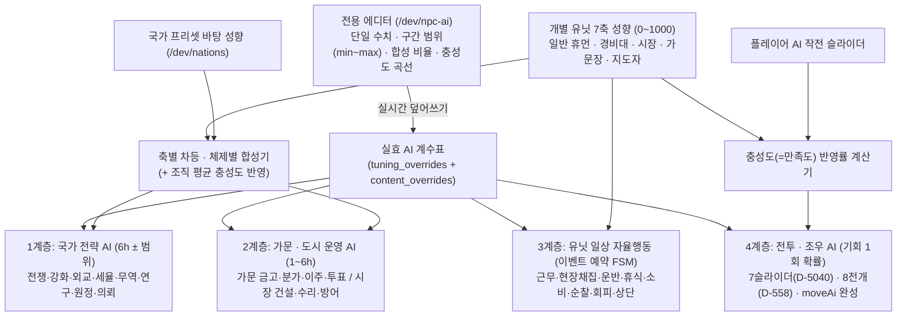

# NPC 자율행동·인공지능 통합 설계: 7축 양극 성향, 충성도 연동 계층 합성, 전용 에디터(/dev/npc-ai)

- 상태: 확정 (2026-11-20, 사용자 승인)
- 날짜: 2026-11-20
- 관련: `docs/PLAN.md` 4.4·6·7장, ADR `2026-11-01-npc-brain-r5.md`, `2026-10-31-faction-society-core.md`, `2026-10-31-combat-core.md`, `2026-11-10-nation-editor.md`, `2026-11-10-editor-input-controls.md`, `2026-11-11-faction-identity.md`, `2026-11-15-combat-moves.md`, `2026-11-15-unloaded-second-maps.md`, 기획 `46_Faction_Society.md`(D-212·D-217·D-253·D-323·D-327·D-554·D-569·D-573·D-5062)·`45_Combat.md`(D-558·D-5039·D-5040)·`41_Time_Units.md`(D-097·D-127)

---

## 배경

### 1. 현재 NPC AI와 성향의 실태 (Verified: 코드 전수 조사)
기존 코드에는 세력 거시 AI(`packages/sim/src/npc/`), 서버 사회 런타임(`apps/server/src/npc/`), 전투 작전 슬라이더(`packages/shared/src/aiTactics.ts`), 2차맵 봇 이동(`apps/server/src/world/bots.ts`)이 구현되어 있다. 그러나 모든 `traits` 참조를 전수 조사한 결과 네 가지 구조적 한계가 드러났다.

1. **기존 4축 성향의 심각한 편중과 미사용 축**:
   - `commerce`(상업): **13곳에 편중**되어 있다 — 거래 마진(`policy.ts`), 상점 판매가(`npcShopPrice.ts`), 도시 건물 상한·붐빔 숙소(`npcGrowthTemper.ts`), 채집소 점수(`build.ts`), 채집 티어(`npcGatherTier.ts`), 지분 매각·보유(`brain.ts`·`npcRun.ts`), 폐허 복원·투자(`brain.ts`·`societyRuins.ts`), 독립 투표(`policy.ts`), 공성 점령 상태(`policy.ts`), 가문 이주비(`policy.ts`), 독재 지배 가문 금고 환류(`rulingVault.ts`), 계약 미지급 대기일(`labor/npcWait.ts`). 한 축이 경제·건설·노동·정치·점령을 모두 좌우해 "짠 상인"과 "과감한 성장국"이 분리되지 않는다.
   - `aggression`(공격): **8곳**에서 전쟁·약탈뿐 아니라 독립 마을·봉신 독립·편입 거부(자치·독립성)와 전투 조우 프리셋(전술성)까지 한꺼번에 맡고 있다.
   - `faith`(신앙): **3곳**(연구 점수 `/8`, 붐빔 숙소, 채집 티어 낮춤)에만 쓰인다.
   - `station`(정거장 태도): **0곳(완전 미사용)** — `packages/sim/src/npc/traits.ts` 주석대로 저장만 되고 어디에서도 읽지 않는다.
   - `leaderPm`(지도자 기질): 4축과 따로 떠다니며 도시 상한·채집 티어 2곳에만 쓰인다.
2. **현재 성향의 작동 방식 — 매순간 확률을 돌리지 않는다 (Verified)**:
   - **점수 가중치(확률 아님, 최고점 1개 고정)**: `brain.ts`·`build.ts`. 6시간(±25%)마다 후보 점수를 합산해 최고 점수 1개를 고른다. 난수는 동점일 때만 쓴다.
   - **연속 선형 공식(확률 아님)**: `policy.ts`·`npcShopPrice.ts`·`npcWait.ts`·`rulingVault.ts`·`npcGrowthTemper.ts`. 0~1000 값이 가격·마진·대기일·환류율·건물 상한으로 직접 환산된다.
   - **문턱 컷오프(확률 아님)**: `policy.ts`·`aiTactics.ts`. 예: `aggression >= 800`이면 무조건 상장폐지, `>= 700`이면 공격적 프리셋.
   - **사건·기회 1회 확률(가중 굴림)**: 딱 3곳만 쓴다 — 공성 점령 처리(`occupationChoice`), 시설별 고정 시드 채집 티어(`temperedGatherTier`), 조우 시 기회 1회 선공 판정(`clashDecide.ts`, 슬라이더 `n × 10%` 확률 = `90% / 50% / 0%`). 전투 틱 안의 ②~⑥ 슬라이더(`combat/moveAi.ts`)는 미구현 스텁이다.
3. **유닛 개별 성향과 가문·지도자 자율행동 부재**:
   - NPC 휴먼(`UNIT_KIND_BOT`)은 숙소 ↔ 일터 ↔ 창고를 왕복할 뿐 개별 성향이 없다(선호 음식·주거만 `condition.ts` 해시).
   - NPC 국가 지도자(`UNIT_KIND_NPC_LEADER`)는 수도 행정 건물 옆에 완전 고정되어 있다(`leaders.ts`).
   - NPC 가문(`npc_houses`)은 표시·랭킹·독재 금고용 틀일 뿐 독자 판단이 없다.
   - NPC 조우 전투에서 전 유닛이 소속 국가 `aggression` 하나로 같은 프리셋을 쓴다.
4. **에디터 분산과 범위 조작 부재**:
   - AI 수치가 `/dev/tuning`(npc·combat 탭), `/dev/nations`(성향 칸)에 흩어져 있고, `최소~최대` 구간을 한 쌍으로 다루는 슬라이더나 실시간 판단 미리보기가 없다.

---

## 선택지

### 1. 성향 소유와 조직 연동 구조
1. **안 A(대장 유닛 단독 종속)**: 유닛만 성향을 갖고, 가문·도시·국가는 대장 유닛 성향을 100% 그대로 쓴다. 서사는 강하나 정권 체제(`D-217`: 독재·민주·자본) 차이가 사라지고, 지도자·시장 교체마다 국가가 급변해 `D-391` 시뮬레이션 안정성이 흔들린다.
2. **안 B(완전 독립 다층)**: 국가·가문·유닛이 서로 무관한 성향을 따로 가진다. 안정적이나 대장이 바뀌어도 조직이 그대로라 살아 있는 느낌이 없고 에디터 복잡도가 3배가 된다.
3. **안 C+(채택 제안: 유닛 성향 원본 + 축별 차등 체제 합성 + 충성도 연동 관철력)**: 모든 유닛이 7축 개별 성향을 원본으로 갖고, 가문·도시·국가의 실효 성향은 **"대장 유닛 + 구성원(가문장·지분) 평균 + 국가 바탕"**을 체제·축 성격·충성도(결속력)에 따라 합성한다. 합성 비중을 에디터 슬라이더로 열어 `대장 100%`로 밀면 안 A처럼도 쓸 수 있다.

### 2. 성향 축 설계
1. **기존 4축 유지**: `station` 미사용·`commerce` 13곳 편중 문제가 그대로 남는다.
2. **기존 4축 + 기질 3축 단순 덧셈**: `commerce` 과부하와 `aggression`의 군사/독립 혼재가 해소되지 않는다.
3. **무손실·양극 7축 전면 재정비 (채택 제안)**: 기존 4축의 의미를 정리·분리해 **죽은 축 0개·편중 축 0개**로 모든 게임 루프를 고르게 나누고, 모든 축의 양극(`0`과 `1000`) 모두 뚜렷한 장단점을 갖게 한다.

### 3. 플레이어 유닛의 개별 성향 반영 방식
1. **무시(작전 슬라이더 100% 고정)**: 조작은 편하나 구인·이적 시 유닛 성향의 전술적 가치가 약해진다.
2. **고정 비율 개입**: 잘 관리한 유닛도 제멋대로 행동해 조작 스트레스가 생긴다.
3. **충성도(=만족도, `D-253`) 연동 반영률 (채택 제안)**: 충성도가 높으면 플레이어 작전 슬라이더가 거의 100% 관철되고, 충성도가 낮아질수록 유닛 개별 성향(특히 자치·야망·담력)의 개입률이 커진다.

### 4. 성향 작동(실행) 엔진 방식
1. **매순간(매 틱) 확률 굴림**: 1초마다 돌격/도주를 오가는 행동 떨림과 누적 확률 왜곡(`10%`를 10번 굴리면 `65%`)이 생긴다.
2. **전 영역 고정 최고점만**: 결정적이나 비슷한 상황에서 다양성이 줄어든다.
3. **사건·기회 기반 4방식 역할 분담 (채택 제안)**: 거시 전략(점수 + 선택적 탐색 온도) · 연속 정책(선형 공식) · 유닛 일상(최소 체류 시간 예약 FSM) · 전투/조우(기회당 1회 시드 확률, `D-5040`)로 역할을 나눈다.

---

## 결정

### 1. 무손실·양극 7축 통합 성향 (`UnitTraits`, 정수 `0~1000`, 중심 `500`)

모든 축은 "높을수록 좋은 능력치"가 아니라 **양쪽 끝(`0` vs `1000`) 모두 장단점이 있는 성향 스펙트럼**이다. 기존 4축과 `leaderPm`은 하위 호환 매핑으로 이어받는다.

| # | 축 ID (기존 매핑) | 양극 스펙트럼 (`0` ↔ `1000`) | 주 영향 영역 (3~5개 분산) | 양극 트레이드오프 (밸런스) |
|---|---|---|---|---|
| 1 | **`belligerence`**<br>(옛 `aggression` 정제) | **평화·수비(0)** ↔ **호전·공격(1000)** | ① 전쟁 선포·강화 수락 ② 공성 약탈 비중 ③ 조우 선공·전투 ①교전·②추격·전개(돌격/지연) ④ 외교 적대·경비대 요격 | 높음: 영토·전리품 빠름 ↔ 전쟁 피로·만족도 하락·무명분 비용.<br>낮음: 평화 번영 ↔ 외부 압박에 수동적. |
| 2 | **`greed`**<br>(옛 `commerce` 분리①) | **공공·자급(0)** ↔ **이윤·시장(1000)** | ① 상점 판매가·거래소 매도 마진 ② 독재 금고 사유화 vs 국고 환류 ③ 도시 지분 매각·상장 유지 ④ 임금 민감도·계약 미지급 대기일 | 높음: 자본·금고 축적 빠름 ↔ 물가 높고 공공투자 인색.<br>낮음: 저렴한 물가·튼튼한 국고 ↔ 자본 성장 느림. |
| 3 | **`boldness`**<br>(옛 `leaderPm` + 담력) | **신중·안전(0)** ↔ **과감·모험(1000)** | ① 채집 티어 선택(고위험 고티어) ② 도시 확장 상한·예비금 배율(`reservePm`) ③ 2차맵 위험지 채집·순찰 반경·도주(`FLEE`) ④ 전투 ③엄폐·⑦퇴각 HP%·달리기/돌진·조우 전력 비 문턱 | 높음: 고티어·빠른 확장·끝까지 버팀 ↔ 패배·부상·재정 고갈 위험.<br>낮음: 파산·전멸 적음 ↔ 성장·티어 상승 느림. |
| 4 | **`communalism`**<br>(옛 `faith` 확장) | **실리·개인(0)** ↔ **공동체·신앙(1000)** | ① 숙소·주거 복지 우선(`lodgingTilt`) ② 신전·정화·오염 억제·가문 배당 ③ 전투 ④호위·밀집 ④ 충성도 자연 방어·반란/회유 저항 | 높음: 높은 민심·오염 억제·튼튼한 방어 ↔ 기술·개인 효율 느림.<br>낮음: 개인 실리·연구 속도↑ ↔ 민심 불안·오염 취약. |
| 5 | **`autonomy`**<br>(옛 `aggression`·`commerce`에서 분리) | **순응·연대(0)** ↔ **자치·야망(1000)** | ① 봉신 독립·새 마을 독립/봉신 ② 자본·민주 독립 투표·편입 거부 ③ 가문 분가·지위(시장·지휘관) 도전 ④ 충성도 하락 시 독자 행동·태업/반란 가속 | 높음: 독립 세력·새 국가 활발히 탄생 ↔ 제국·봉신·명령 통제 어려움.<br>낮음: 안정된 연합·지휘 순응 ↔ 독립·개척 동력 약함. |
| 6 | **`openness`**<br>(옛 `station` 부활·확장) | **폐쇄·보수(0)** ↔ **개방·교류(1000)** | ① 정착 지원금 차등(`D-218`)·가문 이주 정책(지원금 vs 가입비) ② 외교 동맹·교역·의뢰 개방 ③ 기술 연구·폐허 복원 ④ 1차맵 상단/탐험·타 도시 이주 의향 | 높음: 유저·외부 유입, 빠른 연구·교역 ↔ 외부 의존·내부 결속 약화.<br>낮음: 자급·내부 단결·높은 가입비 수익 ↔ 고립·연구 지연. |
| 7 | **`discipline`**<br>(신규 실행 축) | **자유·즉흥(0)** ↔ **규율·성실(1000)** | ① 2차맵 근무/휴식 리듬·자발적 운반·수리 ② 도시 시설 수리·업그레이드(내실) ③ 전투 ⑤스킬 아끼기·⑥대형 간격·진형 유지 ④ 명령 순종 보정(충성도 저하 완충) | 높음: 안정적 생산·수리·칼같은 전술 유지 ↔ 돌발 기회 포착·폭발력 낮음.<br>낮음: 즉흥적 스킬 난사·유연한 이동 ↔ 잦은 휴식·산만한 대형. |

#### 콘텐츠 × 성향 분산 매트릭스 (한 콘텐츠에 최소 2~3축 조합)

| 게임 콘텐츠 | 1차 주축 | 2차 보조축 | 3차 균형·맞바꿈 축 |
|---|---|---|---|
| 전쟁 선포 · 강화 · 약탈 | `belligerence` | `boldness` (전력 비 문턱) | `autonomy` (반란 소탕·해방) |
| 봉신 독립 · 마을 체제 · 독립 투표 · 편입 거부 | `autonomy` | `belligerence` (독재/저항) | `openness` (연대/이탈) |
| 외교 · 정착 지원금 · 가문 이주 정책 · 의뢰 | `openness` | `greed` (가입비 vs 지원금) | `belligerence` (적대/우호) |
| 상점가 · 거래 마진 · 지분 매매 · 독재 금고 | `greed` | `communalism` (공공 환류) | `boldness` (예비금 한도) |
| 도시 건설 · 확장 상한 · 수리 · 업그레이드 | `communalism` (숙소·복지) | `boldness` (확장 상한) | `discipline` (수리·레벨업 내실) |
| 채집 티어 · 2차맵 현장 채집 | `boldness` (고티어·위험지) | `greed` (시세 수익) | `communalism` (안정 저티어) |
| 기술 연구 · 폐허 복원 | `openness` (신기술·복원) | `discipline` (계획 연구) | `communalism` (실리 측 가산) |
| 2차맵 유닛 일상(근무·휴식·운반·소비·이직) | `discipline` (근무·운반) | `greed` (임금·대기일) | `communalism` (신전·선호 소비) |
| 경비대 순찰 · 조우 선공/도주 · 위협 회피 | `boldness` (순찰·맞섬/도주) | `belligerence` (선공·약탈) | `discipline` (임무 유지) |
| 전투 7슬라이더 · 8전개 · 이동 스킬 | `belligerence`(①②) · `boldness`(③⑦) | `communalism`(④) · `discipline`(⑤⑥) | `autonomy` (지휘관 vs 독자 행동) |
| 명령 순종 · 태업 · 반란 · 회유 저항 | **충성도(만족도, `D-253`)** | `autonomy` (독자성↑) | `discipline` + `communalism` (순종↑) |

- **기존 데이터 하위 호환**: 기존 `factions.traits[4]`(`aggression`, `commerce`, `faith`, `station`)는 `belligerence`, `greed`, `communalism`, `openness`로 1:1 매핑하고, `leaderPm`은 `boldness` 기준점으로 읽으며, `autonomy`·`discipline`은 시드 굴림(또는 프리셋 지정)으로 보완한다.

---

### 2. 발전된 안 C+: 축별 차등 체제 합성 + 충성도 연동 관철력

조직의 실효 성향은 **고정값이 아니라 "현재 대장 + 구성원 + 바탕"의 실시간 합성 결과**다.

#### 2.1 축 성격별·정권 체제별 차등 합성 (기본 출발값, 모두 에디터 조작)

같은 조직 안에서도 **결단 축**(`belligerence`·`boldness`·`autonomy`)은 대장의 영향이 크고, **문화·여론 축**(`greed`·`communalism`·`openness`·`discipline`)은 구성원·전통의 영향이 크다.

| 조직 / 체제 | 결단 축 (`대장 : 구성원 : 바탕`) | 문화·여론 축 (`대장 : 구성원 : 바탕`) | 구성원 집계 대상 |
|---|---|---|---|
| **국가 — 독재** (`dictatorship`) | `75% : 5% : 20%` | `55% : 20% : 25%` | 지배 가문장(대장), 소속 가문장 평균 |
| **국가 — 민주주의** (`democracy`) | `40% : 40% : 20%` | `20% : 55% : 25%` | 국가 지도자(대장), 소속 가문장 1가문 1표 평균 |
| **국가 — 자본주의** (`capitalism`) | `35% : 45% : 20%` | `20% : 55% : 25%` | 국가 지도자(대장), 도시 지분(`share_<cityId>`) 가중 가문장 평균 |
| **NPC 가문** (`npc_houses`) | `80% : 20% : 0%` | `60% : 40% : 0%` | 가문장 유닛(대장), 가문원 평균 |
| **도시 내정** (`world_cities`) | `65% : 0% : 35%(국가)` | `50% : 20%(시민) : 30%(국가)` | 시장 유닛(대장), 도시 시민 평균, 소속 국가 실효 |

- 에디터에서 **"체제별 전체 비율"**을 한 번에 조절할 수도 있고, **"축별 세부 비율"**을 펼쳐 미세 조정할 수도 있다. `바탕 0% · 구성원 0% · 대장 100%`로 설정하면 즉시 안 A(대장 단독 종속형)로 동작한다.

#### 2.2 충성도(=만족도, `D-253`) 연동 관철력과 플레이어 유닛 개성 개입

**"부하가 대장(또는 플레이어)의 방침을 얼마나 따르는가"를 충성도 하나의 법칙으로 통합**한다.

1. **플레이어 소유 휴먼 유닛 — 충성도 기반 AI 작전 개입률**:
   - 플레이어가 `TacticsPanel`에서 정한 AI 작전 슬라이더(`playerTactics`)와 유닛 개별 성향에서 산출된 본능 작전(`unitTactics`)을 충성도에 따라 섞는다.
   - 개성 개입률 공식(정수 ‰, 모든 제어점·상한은 에디터 조절):
     ```text
     baseOverridePm = 충성도 구간 선형 보간(loyaltyMilli)
       - 충성도 80~100 (안정 최상): 0‰ ~ 50‰   (플레이어 명령 95~100% 관철)
       - 충성도 50~79  (보통):      50‰ ~ 250‰  (소폭 개성 발현)
       - 충성도 20~49  (태업·경고): 250‰ ~ 600‰ (개성 주도 — 돌출·조기 퇴각)
       - 충성도 0~19   (반란 임박): 600‰ ~ 800‰ (상한 capPm으로 자름)

     traitFactorPm = 1000 + floor((autonomy - 500) * autonomyWeight / 500)
                          - floor((discipline - 500) * disciplineWeight / 500)
                          - floor((communalism - 500) * communalismWeight / 500)

     effectiveOverridePm = clamp(floor(baseOverridePm * traitFactorPm / 1000), minPm, maxPm)
     최종 슬라이더 값 = round((playerVal * (1000 - effectiveOverridePm) + unitVal * effectiveOverridePm) / 1000)
     ```
   - **유닛 종류별 예외(`D-127` 준수)**:
     - **안드로이드**: 만족도가 없다 → 명령 순응도 항상 100%(`overridePm = 0`), 단 펌웨어/코어 프리셋 성향은 보유.
     - **크리쳐**: 만족도가 없다 → 고정 야생 본능 개입률(에디터 설정, 추후 조련/친밀도 연동 자리)로 `belligerence`·`boldness` 개입.
     - **사이보그 본체**: 유저 본인이므로 개입률 `0` (100% 플레이어 설정).
   - **실제 플레이 체감**: 잘 먹이고 좋은 숙소에 재운(충성도 85+) 휴먼은 명령을 100% 칼같이 따른다. 반대로 방치해 충성도가 35까지 떨어진 겁 많은(`boldness` 낮음) 병사는 돌격 명령에도 일찍 퇴각하고, 야망(`autonomy`) 높은 호전적 병사는 수비 대기 명령을 어기고 적을 쫓는다.
2. **NPC 조직의 대장 장악력에도 동일 적용**:
   - 도시·가문·국가 평균 만족도(충성도)가 높을수록 위 표의 `대장 비중`이 그대로 유지되고, 평균 만족도가 반란 예고 구간(`N35`) 아래로 떨어지면 대장 비중이 줄고 구성원/가문장 비중이 올라가며 `autonomy` 높은 가문이 독립·이주·반란을 주도한다.
3. **세대 교체에 의한 조직 진화 (학습 없이 결정적)**:
   - 개별 유닛의 7축 성향은 생성·구인 시 시드 결정적으로 정해져 고정된다(환생 `D-352`·`D-517` 또는 운영자 수정 때만 변경).
   - 유닛은 수명이 있고(`D-097`) 이적·사망·반란·지도자 교체가 일어나므로, 개별 성향은 100% 결정적이면서도 조직 성향은 역사와 함께 살아 움직인다.

---

### 3. 성향 작동 메커니즘 4계층 (매순간 확률 굴림 금지)

성향 숫자가 실제 게임 안에서 어떻게 작동하는지를 **4가지 메커니즘**으로 명확히 분리한다.

| 작동 계층 | 실행 주기 / 시점 | 판정 방식 | 확률 사용 여부 | 떨림·왜곡 방지 장치 |
|---|---|---|---|---|
| **① 국가·가문·도시 전략** | 예약 주기(`6h ± 25%`, 에디터 구간) | **유틸리티 점수 비교** (`brain.ts`·`houseBrain.ts`·`build.ts`) | 기본 **없음**(최고 점수 1개, 동점만 시드 굴림). 선택 옵션: **탐색 온도**(`0` = 완전 결정적, `>0` = 상위 2~3후보 점수차 비례 가중 추첨) | 6시간 단위 실행 + 재선포/강화 쿨타임 |
| **② 연속 정책·경제 수치** | 판단 시점·가격 갱신 시 | **연속 선형·구간 공식** (`policy.ts`·`npcShopPrice.ts`·`blend.ts`) | **없음** (0~1000 → 가격·마진·대기일·예비금·합성률 직접 환산) | 급변 방지 상하한(예: 세율 1회 ±1%p) |
| **③ 2차맵·1차맵 유닛 일상** | 행동 완료(`arrive`·작업 끝) 또는 외부 위협 사건 시 1회 | **유틸리티 점수 + 예약 상태기계(FSM)** (`unitBrain.ts`, 8상태: 근무·현장채집·운반·휴식·소비·순찰·회피·이동) | **없음**(기본) 또는 동점·후보 다양성 1회 시드 굴림 | 상태 진입 시 **최소 체류 시간(`[minMs, maxMs]`)** 보장 + 히스테리시스 보너스(진행 중인 상태에 가산점) |
| **④ 전투·조우 AI** | **기회(Opportunity) 발생 시 1회** (새 적 감지·HP 문턱 통과·행동 완료) | **AI 작전 7슬라이더(`D-5040`) + 8전개(`D-558`)** (`clashDecide.ts`·`moveAi.ts`) | **기회당 1회 시드 확률**(`n × 10%`, 예: `90% / 50% / 0%`) | 한 번 굴린 결정은 **다음 기회가 올 때까지 유지**(매 틱 재굴림 금지) |

---

### 4. 4계층 자율행동 통합 구조



#### 계층별 핵심 추가 기능
1. **국가 전략 AI**: 기존 `brain.ts`·`policy.ts`를 7축 실효 성향 입력으로 전환 + NPC 간 공성전 연결 스위치 + 외교 호감·신뢰 점수 + 의뢰 자동 발행(`D-336`).
2. **가문·도시 AI**: `packages/sim/src/npc/houseBrain.ts` 신설(가문 금고 투자/환류/배당, 분가·개척, 이주, 민주·자본 안건 투표 `D-5057`), 시장 유닛 성향을 `build.ts`·`npcGatherTier.ts`에 직접 연결(`D-5062`).
3. **유닛 자율행동 AI**: `packages/sim/src/npc/unitBrain.ts` 신설(8상태 예약 FSM) + `leaders.ts` 지도자 수도 순회 + 경비대 순찰 반경 + 4단계 시뮬레이션 상세도(`PLAN 4.4`: 구독 2차맵 풀 연출, 무관측 2차맵 같은 성향 공식으로 기대값 일치 정산).
4. **전투·조우 AI**: `combat/moveAi.ts` 스텁 완성(`wantsRun`·`moveSkillAllowed`) + `tacticsFromTraits`로 7축 성향 → 7슬라이더·8전개 방식 연속 매핑 + 충성도 반영률 적용 + 경비대/원정대 조우 판단 개방.

---

### 5. 전용 에디터 패널 설계: `/dev/npc-ai`

기존 `tuning_overrides` + `content_overrides` + `Draft → Check → Live Apply → Export(pnpm tuning:apply)` 파이프라인을 100% 재사용한다.

1. **수치와 구간 범위(`min~max`)를 함께 조작하는 구조**:
   - 모든 구간 값(성향 생성 최소~최대, 판단 주기 최소~최대, 상태 최소 체류 시간, 순찰 반경, 퇴각 HP 범위 등)을 `*_min` / `*_max` 쌍 튜닝 키로 등록하고, `tuningChecks.ts`에 `ai_range_order`(`min <= max`) 및 `ai_blend_sum`(합 1000‰) 교차 검사를 추가한다.
   - 공용 이중 손잡이 슬라이더 **`RangeControl`**(`apps/game/src/editor/content/contentEditorRange.tsx`, 외부 의존성 0)을 기존 `NumberControl`·`DistributionControl` 옆에 추가한다.
2. **5개 탭 구성**:
   - **탭 1 — 성향 · 계층 합성 · 충성도 곡선**: 7축 생성 구간(`[min, max]`), 직군별(시민·경비대·지도자·구인 카드) 분포 범위, 체제별·축별 합성 비율 막대(합 100%), 충성도 구간별 개성 개입률 곡선(SVG 그래프 + 제어점 슬라이더), 원클릭 프리셋(`[대장 100%]`·`[체제 균형]`·`[전통 안정]`), 시드 200명 분포 히스토그램.
   - **탭 2 — 유닛 자율행동(FSM)**: 8개 상태 기본 점수·7축 가중치, 최소 체류 시간·재평가 주기·순찰 반경·위험 감지 거리 구간(`[min, max]`), 가상 유닛 하루 24시간 예상 시간표 막대, 런타임 기능 스위치.
   - **탭 3 — 국가 · 가문 · 도시 전략**: 기존 `npc.*` 계수들을 행동 카드별(전쟁·강화·개척·연구·세율·거래·증축·구인·가문 금고)로 통합 편집 + 탐색 온도 설정 + `/dev/nations` 바로가기.
   - **탭 4 — 전투 · 조우 AI**: 4프리셋 출발값(`C39`), 7축 → 7슬라이더·8전개 매핑 가중치, `moveAi` 스태미나·스킬 문턱, 조우 전력 비 범위(`encounter_*`), 성향 입력 시 실시간 산출 슬라이더 미리보기.
   - **탭 5 — AI 판단 실험실 & 라이브 인스펙터**: 가상 7축·상황·충성도를 슬라이더로 움직여 실제 순수 함수(`decideAction`·`decideUnitState`·`tacticsFromTraits`)의 **행동별 점수 분해표와 최종 선택**을 즉시 확인 + 실제 서버 NPC 국가·가문·유닛 조회 및 운영자 성향 덮어쓰기(감사 기록).

---

### 6. 저장 · 성능 · 안전 · 단계별 로드맵

- **DB(추가만, 직전 판 호환)**: `world_humans.traits smallint[]`(길이 7, 각 `0~1000`), 지도자·비휴먼 유닛용 `unit_ai_traits`(또는 `world_units.traits`), `npc_houses.traits_override smallint[]`. 기존 `factions.traits[4]`는 유지하며 7축 변환 계층을 둔다.
- **성능 예산(`ADR 27` 10만 유닛 · NAS 루프 p99 < 50ms)**:
  - 메모리: 10만 유닛 × 7축 `Int16Array`(14바이트) ≈ **1.4MB** (**Assumed**: 산술).
  - CPU: 조직 합성은 판단 주기(6시간)와 대장 교체 시에만 계산, 유닛 일상은 예약 시각에만 실행, 무관측 2차맵은 기대값 정산.
  - 비상 스위치: `npc_unit_ai_enabled`·`npc_house_ai_enabled` 런타임 스위치 추가.
- **모듈 경계·보호 규칙**: 순수 판정·합성·점수는 `packages/shared/`와 `packages/sim/src/npc/`에만 두고 `apps/game`은 `packages/sim`을 import하지 않는다. 판정 변경 단계마다 `SIM_VERSION` 올림 + 골든 해시 시험 갱신. `docs/design/` 미러는 건드리지 않는다.

| 단계 | 범위 | 핵심 산출물 | 검증 기준 |
|---|---|---|---|
| **1단계** | 7축 성향 모델 · 축별/체제별 합성기 · 충성도 반영률 공식 · DB 마이그레이션 | `packages/shared/src/unitTraits.ts`, `packages/sim/src/npc/blend.ts`, 기존 `brain.ts`·`policy.ts`·`build.ts` 7축 분산 이행, 마이그레이션 1건 | 결정성·단위 테스트, `econ16`·`war16` 30일 시뮬 굶어 멈춤 0 (`D-220`) |
| **2단계** | 공용 `RangeControl` + `/dev/npc-ai` 1차(탭 1·3·5) | `contentEditorRange.tsx`, `apps/game/src/editor/npcAi/`, tRPC `npcAi.preview`·`inspect`, ko/en 문구 | 구간 검사·실시간 적용·내보내기(`pnpm tuning:apply`)·`break-ui` 점검 |
| **3단계** | 유닛 8상태 예약 FSM · 가문 AI · 지도자 순회 · `/dev/npc-ai` 탭 2 | `unitBrain.ts`, `houseBrain.ts`, `bots.ts`·`humanPlaces.ts`·`leaders.ts` 확장 | 구독 vs 무관측 2차맵 기대값 일치 통계 시험, 2차맵 동작 확인 |
| **4단계** | 전투 `moveAi.ts` 완성 · 7축→작전/전개 매핑 · 충성도 개입 · `/dev/npc-ai` 탭 4 | `combat/moveAi.ts`, `tacticsFromTraits.ts`, `clashDecide.ts` 확장 | 전투 결정성·6v6 리플레이·충성도별 행동 분화 시험 |
| **5단계** | NPC 1차맵 상단/원정(옵션) · 외교 호감 · 의뢰 발행 · 대규모 부하 검증 | 180일 `D-391` 검증, NAS 루프 p99 < 50ms 실측 | `D-391` 통과, `pnpm check` 전체 통과 |

---

## 이유

- **7축 분산 재정비**: 실제 코드 전수 조사 결과 `commerce`가 13곳을 독점하고 `station`은 0곳 미사용이었다(**Verified**: `packages/sim/src/npc/`·`apps/server/src/` grep). 7축 양극 스펙트럼으로 분리하면 모든 축이 4개 내외 영역을 맡아 죽은 축과 만능 축이 동시에 사라진다.
- **충성도 연동 관철력**: `D-253`(만족도 = 충성도)과 `D-534`(잘 관리된 상태가 중요)를 지휘 통제력으로 연결하면, 관리가 잘된 유닛은 플레이어 의도대로 움직이고 방치된 유닛은 개성대로 돌출하는 자연스러운 리스크·보상 구조가 생긴다(**Assumed**: 게임플레이 기대 효과, 구현 후 플레이 테스트로 검증).
- **사건·기회 기반 4방식 분리**: `D-323`(결정적 점수+규칙식)과 `D-5040`(기회당 1회 확률)을 유지하면서 10만 유닛 환경에서도 NAS CPU 예산(p99 < 50ms)을 지킬 수 있다(**Assumed**: 기존 R5 측정값 1천 유닛당 0.0002ms/초 기준 외삽, 5단계에서 실측).

---

## 결과

- **좋은 점**:
  - 국가·가문·도시·유닛·전투가 하나의 7축 성향 언어와 충성도 법칙으로 일관되게 연결된다.
  - 정권 체제(독재·민주·자본)와 지도자/시장/가문장 세대 교체가 실제 정책 변화로 드러난다.
  - 개발자가 `/dev/npc-ai` 한 곳에서 수치·범위·합성 비율·충성도 곡선을 조절하고 즉시 점수표로 결과를 확인할 수 있다.
- **감수할 점**:
  - 기존 `factions.traits[4]`에서 7축으로 전환할 때 기존 시뮬레이션 시나리오와 골든 해시(`SIM_VERSION`)를 갱신해야 한다.
  - 기획서 정본(`docs/design/`, 별도 기획 세션 관리)의 `D-327`(4축)과 `D-5040`(플레이어 작전 우선)에 새 축·충성도 개입 규칙을 반영하도록 기획 질문 전달이 필요하다.
- **다시 볼 조건**:
  - 1단계 30일 시뮬레이션에서 7축 분산 후 독점·파산·굶어 멈춤 지표가 나빠지면 가중치 출발값을 조정한다.
  - 플레이어 유닛의 충성도 개입이 전투 체감상 불편하면 기본 곡선의 안전 구간(개입 0%)을 충성도 50 이상으로 넓힌다.

---

## 구현하며 확정한 세부 (2026-11-20, 1~2단계)

1. **DB 저장 위치 통합**: 모든 유닛 종류(휴먼·경비대·지도자·사이보그 유닛·크리쳐·안드로이드)의 7축 성향을 중복 없이 `world_units.traits smallint[]`(길이 7, 각 `0~1000` CHECK 제약, null 허용) 한 열로 통합한다. NPC 가문 덮어쓰기는 `npc_houses.traits_override smallint[]`(길이 7, 각 `0~1000`, null 허용)로 둔다.
2. **플레이어 휴먼 만족도 미구동 대비 (Verified)**: 현재 서버에서 플레이어 고용 휴먼의 만족도 변화 루프는 아직 돌지 않는다(`populationSchema.ts`·`roster/services.ts` 확인). 따라서 충성도 반영률 공식은 `loyaltyMilli === null`(또는 미집계)일 때 안전하게 `0‰`(플레이어 작전 100% 순종)을 반환한다.
3. **충성도 개입 곡선 출발값**: 기본값으로 충성도 `80~100` 구간 `0~50‰`, `50~79` 구간 `50~250‰`, `20~49` 구간 `250~600‰`, `0~19` 구간 `600~800‰`(상한 `800‰`)을 쓰고 `/dev/npc-ai`에서 실시간 수정한다.
4. **기존 4축 시나리오 회귀 보호**: 기존 4축(`factions.traits`)만 넘기는 호출은 기존 결과를 유지하고, 7축(`UnitTraits`) 실효 성향이 연결된 경로에서 7축 분산 규칙이 작동한다.
